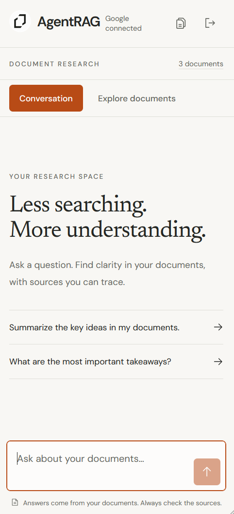
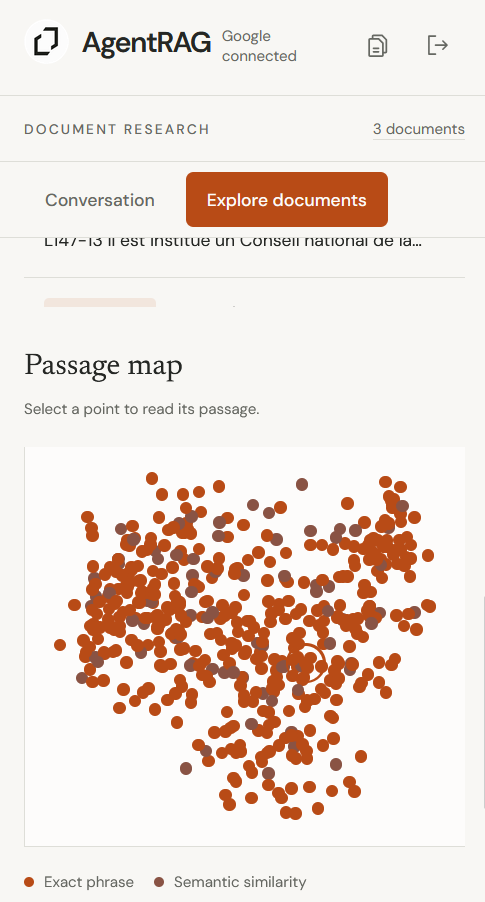
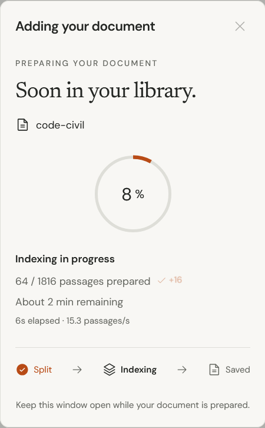
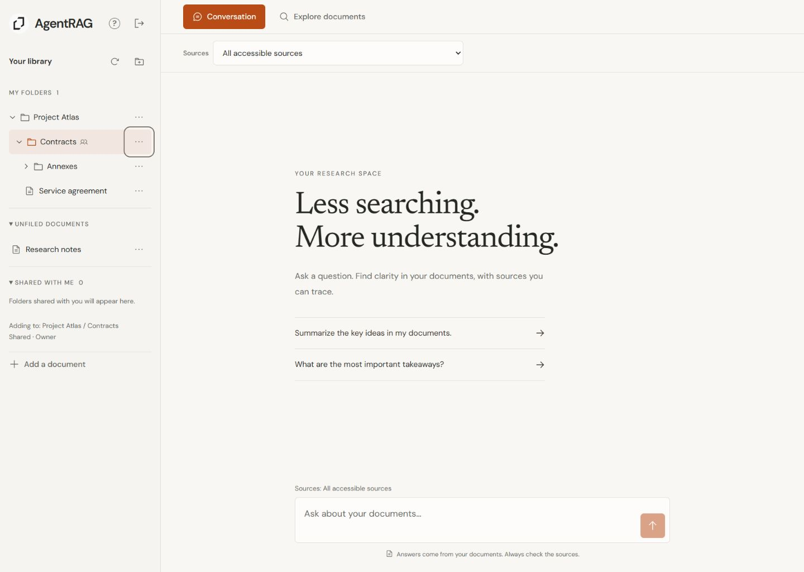

<p align="center">
  
</p>

<h1 align="center">AgentRAG</h1>

<p align="center">Ask questions, explore your documents and find answers grounded in your sources.</p>

RAG chat agent built with .NET 10, Microsoft Agent Framework, EF Core (PostgreSQL + pgvector), ASP.NET Core Identity and a React (Vite) front end. Connect it to Claude or Codex using the authenticated `/mcp` endpoint or the local stdio bridge; see [MCP setup and client configurations](MCP.md).

- `src/AgentRag.Api` – .NET 10 API (Identity bearer-token endpoints under `/api/auth`, documents `/api/documents`, chat `/api/chat`). Documents are chunked, embedded (OpenAI) and stored in PostgreSQL as native pgvector vectors (HNSW index, pgvector 0.8+; `vector(1536)`, the size of `text-embedding-3-small`) with a `pg_trgm` index on passage text. Retrieval goes through three levels, exposed as MCP tools and used by the agent: `grep_passages` (literal/regex), `search_knowledge_base` (vector index) and `search_exhaustive` (exact vector scan); `read_passages` reads a match with its neighbours. A GitHub repository can be connected to a folder (`/api/repositories`, read-only personal access token stored encrypted): its text files are mirrored as documents through the GitHub REST API and re-synchronised incrementally on demand; source code is split on line ends and searched with grep only, documentation files are also embedded.
- `web` – React + TypeScript UI.
- `tests` – xunit tests.

Organize documents in nested folders and share a subtree with registered users using Read or Write access. Permissions are inherited by all descendants; owners manage sharing. Conversation, Explore and MCP search the same authorized sources, with an optional folder scope. See [shared folders, permissions and API](SHARED-FOLDERS.md).

## Screenshots

### Conversation

Ask questions about your documents and get answers with traceable sources.

<p align="center"></p>

### Passage exploration

Explore document passages and their relationships on a visual map.

<p align="center"></p>

### Document indexing

Follow the progress as a document is prepared for search.

<p align="center"></p>

### Shared folders

Keep the existing research workspace while organizing and sharing sources from the sidebar.

<p align="center"></p>

## Run
1. Set `ConnectionStrings:DefaultConnection` and `OpenAI:ApiKey` (e.g. `dotnet user-secrets`).
2. `dotnet run --project src/AgentRag.Api` (the default Development profile listens on `http://127.0.0.1:5000` and applies migrations automatically).
3. `cd web && npm install && npm run dev`, then open `http://127.0.0.1:5173`. The API proxy defaults to port 5000; override `API_PROXY_TARGET` in `web/.env` only if using another port. Google/OAuth configuration is described in [OAUTH.md](OAUTH.md).

## Production deployment

The GitHub Actions workflow deploys `main` to the IIS site configured in GitHub secrets, and can also be started manually. Configure `WEBSITE_NAME`, `SERVER_COMPUTER_NAME`, `SERVER_USERNAME` and `SERVER_PASSWORD` from the WebDeploy publishing credentials for agentrag.runasp.net. The workflow builds the React app and publishes it with the .NET API. The host must support ASP.NET Core 10 and WebDeploy.

Configure production settings independently on the host, including `ConnectionStrings__DefaultConnection` for PostgreSQL with pgvector, `OpenAI__ApiKey`, and the OAuth settings described in [OAUTH.md](OAUTH.md). Apply EF migrations to the production database before deploying a version that requires them; the workflow does not migrate production automatically. Store secrets outside the deployed directory so deployment cannot overwrite them. Verify the host's HTTPS and streaming configuration before use.

## Document imports

Add documents by pasting text or uploading a PDF, TXT, Markdown (`.md`) or CSV file. Uploads use `POST /api/documents/upload` with multipart fields `file` and optional `title` (defaults to the filename), and return the same NDJSON progress events as `/api/documents/ingest`. Each file is limited to 10 MB and extracted text to 2 million characters. Text files should use UTF-8 (UTF-16 with a byte-order mark is also supported).

PDF text is extracted page by page using PdfPig before chunking and embedding. Scanned/image-only PDFs require OCR beforehand; OCR is not included. Empty, unreadable, password-protected and unsupported files return a validation error before indexing. Only the extracted text is stored; the original file is not retained. Imports accept an optional `folderId`, including as a multipart field. Shared contributions belong to the folder's owner, retain their contributor identity, and inherit folder access. Unfiled imports remain private to the signed-in user.

## PostgreSQL storage

Identity users, folders, membership grants, documents and embeddings share the PostgreSQL database. Install pgvector on the PostgreSQL server; the initial EF migration enables the `vector` extension (the migration account needs permission to create it). Retrieval computes cosine similarity and limits results in PostgreSQL, restricted to documents accessible to the current user through ownership or inherited folder sharing. The native `vector` column accepts the configured model's dimensions; use the same embedding model for ingestion and search and re-ingest documents when changing models.

Set the development connection outside tracked configuration:

```powershell
dotnet user-secrets set "ConnectionStrings:DefaultConnection" "Host=<public-host>;Port=5432;Database=<database>;Username=<user>;Password=<password>;SSL Mode=Require" --project src/AgentRag.Api
```

Use the hosting provider's public hostname and enable remote access for local development. Production can use `ConnectionStrings__DefaultConnection`. Development automatically applies migrations; for a deployment run `dotnet ef database update --project src/AgentRag.Api` with the target connection configured. The PostgreSQL initial migration replaces the previous SQL Server schema: existing SQL Server accounts and documents are not imported. Users must register again and documents must be re-ingested.

## Web interface

Chat answers stream from `POST /api/chat/stream` using the agent's native streaming API, including its knowledge-base tool. The authenticated NDJSON stream emits `started`, `delta` (answer text), `completed`, `error`, and heartbeat events. The UI appends text to one Markdown answer while generating and marks interrupted answers as incomplete. Retrying replaces the incomplete answer without duplicating the question. Disconnecting cancels both generation and retrieval. Chat logs record the time to first text, total duration, completion, failures and cancellations without logging questions or answers. The original JSON `POST /api/chat` endpoint remains available.

Both chat endpoints accept `{ "message": "My name?", "libraryRevision": "<revision from GET /api/library>", "history": [{ "role": "user", "content": "My name is Mathieu." }] }`, plus an optional `folderId` to scope research to a folder and its descendants. History is optional and only accepts non-empty `user` and `assistant` messages. Requests with history require the current library revision; changed sources or permissions return 409 so the client can clear old context. The UI sends completed exchanges from the current open conversation, excluding interrupted replies and duplicate retry questions. History is held in page memory and resets on reload, sign-out, source-scope changes or detected access changes. The agent can recall conversational details directly; document questions still require knowledge-base retrieval. Request cancellation is handled normally by both streaming endpoints and stops their producers and heartbeats without propagating an unhandled cancellation exception.

Document additions stream progress from `POST /api/documents/ingest`: splitting, completed embedding passages, quota waits with a retry countdown, and PostgreSQL persistence. A terminal `completed` event confirms that the document is saved; errors leave the form text available to retry. Disconnecting cancels unfinished work. This is a request-scoped operation, not a durable background job; do not close the page while indexing. The original JSON `POST /api/documents` endpoint remains available.

Configure `Ingestion:BatchSize` (default 16 passages) and `Ingestion:MaxRetries` (default 3 additional attempts per batch) in API settings or environment variables. Embedding requests are serialized within each API process. HTTP 429 rate limits respect `Retry-After` (seconds or date) and millisecond headers; missing headers use exponential backoff starting at 60 seconds. SDK retries are disabled for the embedding client so waits are visible. Completed batches are kept in memory during retries; nothing is saved until all batches succeed. Permanent quota/billing errors are not retried. This cannot increase the Azure deployment quota; adjust that quota if requests remain rate-limited.

API console logs include timestamps, request/ingestion scopes, chunk counts, batch durations, retry delays, persistence completion, errors and cancellations. Document text and embeddings are not included in application logs. Proxies must allow streaming and long responses; the API sends a heartbeat every 10 seconds and the bundled Nginx configuration disables response buffering.

### Long ingestions

There is no application-wide duration limit on ingestion. The streaming response remains active during embedding calls, serialization behind other embedding requests, quota backoff and database persistence. The ingestion endpoints explicitly opt out of ASP.NET request-timeout middleware. The browser API client has no timeout timer, and the Vite API proxy explicitly disables socket timeouts. Leaving or reloading the page while an ingestion is active triggers the browser's standard confirmation where supported.

- `OpenAI:NetworkTimeoutSeconds` defaults to `1800` (30 minutes **per model network operation**, not per document). Set `OpenAI__NetworkTimeoutSeconds` to override. The shared named HTTP client has no competing shorter timeout; the SDK enforces the configured deadline. Embedding SDK retries remain disabled so quota waits stay visible.
- `Ingestion:SaveCommandTimeoutSeconds` defaults to `600` (10 minutes per database command during the final save). Set `Ingestion__SaveCommandTimeoutSeconds` to override. The previous EF command timeout is restored after success or failure, so normal retrieval queries retain their own limits.
- Bundled Nginx API read/write idle limits are one hour; these are gaps between I/O operations, not total response limits. Heartbeats are flushed every 10 seconds and buffering/compression are disabled for API responses. Rebuild/redeploy the frontend container to apply Nginx changes; restart Vite to apply development proxy changes.
- The regression suite simulates a 22-minute embedding call and verifies at least 121 flushed heartbeats followed by a single successful save. It does not exercise a real deployed proxy, network, database or model for 22 minutes.

Any additional ingress/CDN, IIS hosting, model gateway or database service can impose independent limits. Configure those to allow long streamed requests; heartbeats only prevent idle timeouts, not a hosting provider's hard total-duration limit. Network loss, browser/device suspension, forced navigation, API restarts and exhausted provider retries can still interrupt this request-scoped operation. Surviving those interruptions requires a persisted background job and resumable progress, which this implementation does not provide. A finite per-call deadline intentionally remains so a stalled provider cannot hold the shared embedding gate forever.

The mobile-first INDEX interface uses Tailwind CSS 4 and shared React components. See [web/README.md](web/README.md) for development, frontend tests and container deployment, and [web/DESIGN_SYSTEM.md](web/DESIGN_SYSTEM.md) for theming and branding a fork. The default frontend uses same-origin `/api` requests; the API launch profile and `API_PROXY_TARGET` both default to `http://127.0.0.1:5000`.

## Passage exploration

Open **Explore documents** to search passages and inspect their 2D PCA projection. The authenticated `POST /api/explore` accepts `query` and optional `documentId`; all queries are restricted to the current owner. The map includes at most the first 500 passages in stable ID order, with an explicit sample notice when truncated. Search scores and exact phrase checks cover that sample only. Scores use full-vector cosine similarity; projection distances are approximate. No migration is required.
